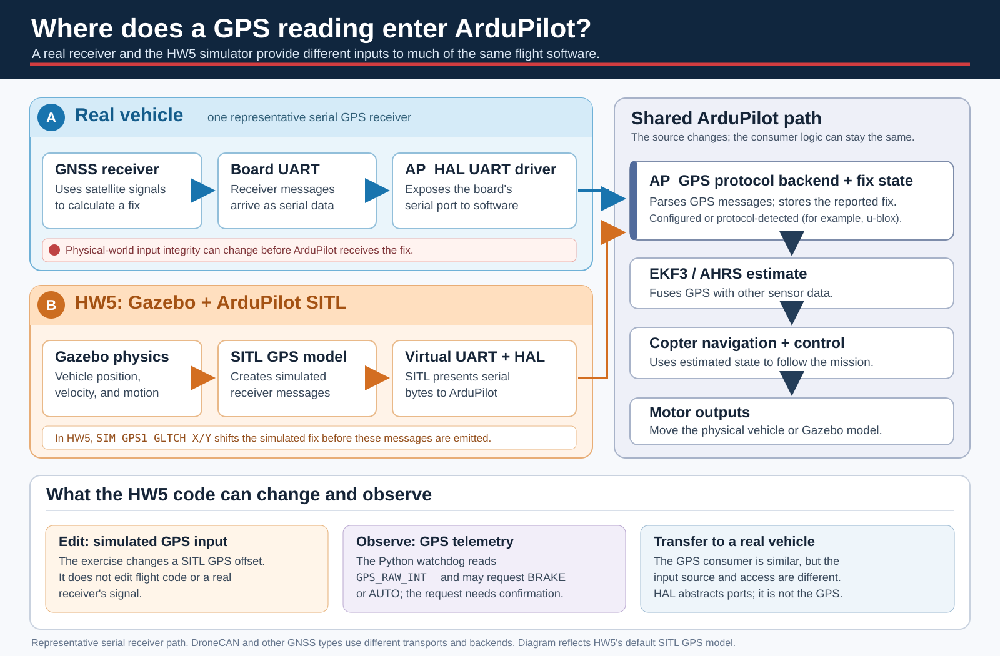

# If you want to take a deeper dive: where the GPS edit goes

This page is optional. It describes the **public-source local practice flight**:
ArduPilot Copter SITL controls an Iris drone in Gazebo. The practice route is a
small square over a generic runway. It is not the CTF2 stadium mission.

## Follow one measurement

```text
Gazebo drone position (simulator reference)
          │
          ▼
ArduPilot's simulated GPS sensor  ◀── attack.py requests an offset
          │                         through SIM_GPS1_GLTCH_X/Y
          ├── GPS_RAW_INT ──► student_watchdog.py
          │                         │
          ▼                         └── may request BRAKE or AUTO
ArduPilot position estimate                  │
          │                                  ▼
ArduPilot navigation and motors ◀──── flight-mode request
          │
          ▼
Gazebo moves the drone ──► next simulated sensor reading
```

Gazebo has a reference position for the simulated drone. ArduPilot uses that
world to generate sensor readings, including GPS. The local attack changes the
**GPS reading**, not Gazebo's reference position. The flight controller then
uses its sensor inputs to estimate where it is and decide how to fly. That may
eventually change where the simulated drone actually goes.

The runner saves three different tracks in each route plot:

1. **Simulator reference:** where the drone is in Gazebo's model.
2. **Reported GPS:** the position delivered as a GPS reading.
3. **Controller estimate:** ArduPilot's current position estimate.

These tracks need not agree during an attack. None is a measurement from a real
drone. The watchdog receives only the reported GPS message; it does not get the
simulator reference track.

## What changes on a physical drone?

The flight code still needs a position measurement, but a physical drone has a
**GPS receiver and antenna** instead of a simulated one. Here is one common
ArduPilot arrangement: a serial GPS receiver that speaks the u-blox protocol.
Other receivers and transports, including DroneCAN, use different backends.



| Stage | Physical flight, serial GPS example | This SITL exercise |
| --- | --- | --- |
| Where position starts | Satellite signals reach an antenna; a receiver computes and reports a fix. | Gazebo models the vehicle's motion. ArduPilot's simulated GPS uses that simulated state to make a sensor reading. |
| What carries the reading | Receiver messages arrive over a flight-controller serial port. | A simulated GPS device supplies messages through a **virtual** serial port. |
| Hardware abstraction layer | A board-specific `AP_HAL` serial driver provides the bytes to the rest of ArduPilot. | `AP_HAL_SITL` provides the same kind of serial interface without a physical UART. |
| GPS interpretation | An `AP_GPS` backend parses the receiver protocol and provides a GPS fix. | An `AP_GPS` backend consumes the simulated receiver data. |
| Position used for flight | The estimator combines GPS with other sensor data; navigation uses its **estimate**, not a direct copy of each GPS fix. | The estimator and navigation still run. The `GPS_RAW_INT` and position-estimate tracks can diverge. |

**HAL means hardware abstraction layer.** It gives higher-level code an
interface to board resources such as serial ports. HAL does **not** replace the
GPS antenna or receiver, parse the receiver's GPS protocol, or decide that a
fix is trustworthy. The separate `AP_GPS` library handles GPS protocols and
state; the estimator decides how GPS measurements contribute to the vehicle's
position estimate. ArduPilot's [library guide](https://ardupilot.org/dev/docs/apmcopter-programming-libraries.html)
separates `AP_HAL` from `AP_GPS`, and its [Copter EKF guide](https://ardupilot.org/copter/docs/common-apm-navigation-extended-kalman-filter-overview.html)
explains how GPS is combined with other measurements.

This is the useful boundary to remember:

```text
physical receiver + board serial driver  ─┐
                                         ├─► AP_GPS fix ─► estimator ─► navigation
simulated receiver + SITL serial driver ──┘
```

The hardware-specific I/O and the sensor source change; much of the code that
**uses** a GPS fix is shared. The pinned ArduPilot source makes this concrete:
[`AP_HAL::HAL` lists a first-GPS serial driver](https://github.com/ArduPilot/ardupilot/blob/d9c5097c3d8333435712ffed86bca8ce00c4bb46/libraries/AP_HAL/HAL.h#L20-L30),
[`AP_HAL_SITL` connects its GPS port to a simulated serial device](https://github.com/ArduPilot/ardupilot/blob/d9c5097c3d8333435712ffed86bca8ce00c4bb46/libraries/AP_HAL_SITL/UARTDriver.cpp#L70-L87),
and [`AP_GPS` selects a protocol backend](https://github.com/ArduPilot/ardupilot/blob/d9c5097c3d8333435712ffed86bca8ce00c4bb46/libraries/AP_GPS/AP_GPS.cpp#L744-L780).
ArduPilot also supports a direct `AP_GPS_SITL` backend in some configurations;
the serial receiver path is the useful analogy for this exercise.

### Where would an incorrect reading enter?

Our `attack.py` changes a **SITL GPS simulation parameter**. The pinned
[`SIM_GPS.cpp`](https://github.com/ArduPilot/ardupilot/blob/d9c5097c3d8333435712ffed86bca8ce00c4bb46/libraries/SITL/SIM_GPS.cpp#L550-L566)
adds the configured offset to the generated latitude and longitude before the
simulated receiver publishes the reading. A physical flight has no Gazebo
reference position and no such exercise parameter. An incorrect physical GPS
fix could originate earlier, from the signals received by the antenna, from a
faulty receiver, or from the receiver-to-controller link. Which parts of the
system an adversary can influence is a separate access question; the local
parameter edit does not demonstrate access to any of those physical paths.

The supplied `student_watchdog.py` is **outside the flight controller**. It
reads `GPS_RAW_INT` over MAVLink and can request a flight-mode change. On a
physical vehicle, a similar monitor would need a defined, trusted place to
run, a dependable telemetry/control link, and a safe response if that link
fails. It would still need evidence beyond one GPS stream to tell a bad fix
from real movement. We have Gazebo's reference track for evaluation here;
there is no equivalent perfect truth track on an ordinary physical flight.

## The two files your team edits

In `attack.py`, `AttackPlan` specifies when the GPS offset starts, how long it
lasts, its north/east direction, and its maximum ramp rate. For example:

```python
AttackPlan(start_s=25.0, hold_s=20.0,
           north_m=20.0, east_m=0.0, ramp_m_per_s=25.0)
```

The runner converts that offset from metres to latitude/longitude degrees and
sets ArduPilot SITL's `SIM_GPS1_GLTCH_X/Y` parameters. A parameter confirmation
means SITL accepted the setting. Check later GPS samples and the simulator
reference track before claiming the flight changed.

In `student_watchdog.py`, `Watchdog.update(gps_msg, now_monotonic)` receives each
fresh `GPS_RAW_INT` sample. The supplied watchdog compares the reported position
change with movement implied by the GPS speed and course. Its central decision
looks like this:

```python
if residual_m > threshold_m:
    return "BRAKE"
```

The returned word is a **request**. `runner.py` sends it to ArduPilot. A later
`mode_confirmed` event comes from the flight controller's heartbeat and shows
that the mode actually changed. Likewise, `AUTO` is a request to resume, not
proof that the mission completed. Check `mission_completed`, the route plot,
and the event trace together.

## What the four runs can tell you

Compare the same attack with the supplied watchdog and your revised watchdog.
Then run without an attack to see whether your revision interrupts ordinary
flight. A GPS jump may be easy to catch while a smooth drift may stay below a
jump threshold. A quiet interval does not necessarily mean the GPS position is
correct again. Those are design assumptions to test, not hidden answers.

This local exercise changes **SITL simulator parameters**. CTF2 uses a
different, private sensor-edit interface and arbiter. The local results teach
the sensor-to-decision loop, but they do not prove what would happen in the CTF2
stadium mission, on a physical drone, or under an actual RF/network attack.
